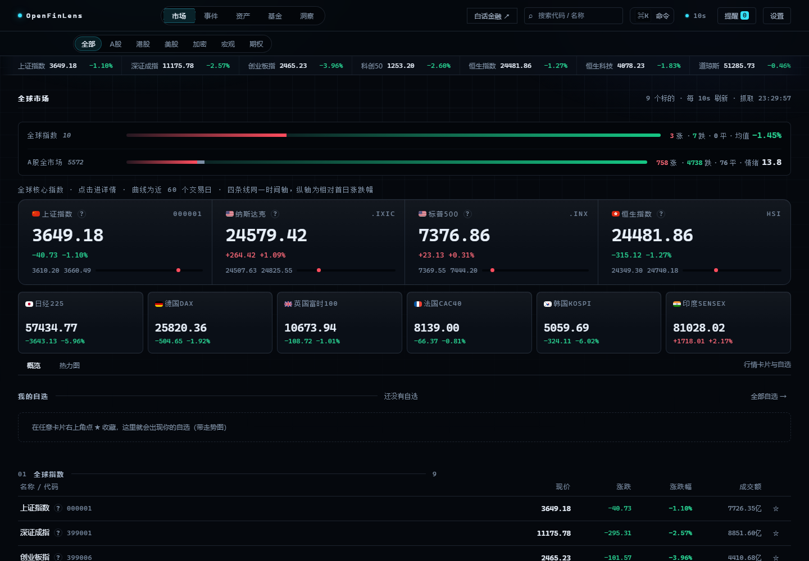

<div align="center">

# 🔭 OpenFinLens

**A股 · 港股 · 美股 · 加密 · 全球事件，一块屏幕读完的纯前端行情终端。**

没有后端，没有 API key，没有构建步骤。clone 下来 `node scripts/serve.mjs`，它就跑起来了。

**[线上体验 →](https://5777-wq.github.io/openfinlens/)**　·　**[下载安卓 APK](https://github.com/5777-wq/openfinlens/releases)**

[](LICENSE)
[](https://github.com/5777-wq/openfinlens/releases)
[](.github/workflows/ci.yml)



</div>

## 为什么有它

行情、龙虎榜、南向资金、全球事件，这些数据本来就是免费的，躺在各家公开接口里；收费的只是把它们拼上同一块屏幕——参考价：Bloomberg Terminal，一年三万美元上下。OpenFinLens 在你的浏览器里直接把数据抓回来、拼成一块屏幕，所有计算都在你自己的机器上完成，连 `node_modules` 都没有。

## 怎么用

| 方式 | 做法 |
|---|---|
| 在线 | 打开 [5777-wq.github.io/openfinlens](https://5777-wq.github.io/openfinlens/)，支持 PWA 安装到桌面 |
| 本地 | `git clone` 后 `node scripts/serve.mjs`（默认 8765；`/academy/` 与 `/openfinlens/` 前缀同站可用） |
| Android | [Releases](https://github.com/5777-wq/openfinlens/releases) 签名 APK（Actions 自动构建上传，不入库），只申请 `INTERNET` 一个权限；`cd android && bash build.sh` 可自建 |
| 自部署 | push 到你的仓库 → Settings → Pages → Source 选 **GitHub Actions**（deploy-pages.yml 会拼装站点）；访问不到币安 / OKX 时可选 `wrangler deploy worker.js` 起代理 |

只有改源码才需要构建：`node _scripts/build-js-bundle.mjs` 或 `node _scripts/build-css.mjs`（打包产物已提交在仓库里）。

## 仓库结构（三合一 Monorepo）

```
apps/terminal/   行情终端（主站 /）——含「美股信号」Tab（Meridian）
apps/academy/    白话金融科普站（子站 /academy/）
content/         Academy 文章与术语源
core/            三仓共享内核：engine（指标唯一真源）/ sources（三级降级链）/ registry / vendor / bridge
pipelines/       meridian（美股收盘信号）/ academy（长历史序列）采集管线
data/            采集产物（由 3 条采集 workflow 推 data 分支，deploy 时拼装回站点）
test/            统一离线测试入口（主仓 + Academy 两套件）
```

## 核心功能

| 模块 | 能做什么 |
|---|---|
| 全市场热力图 | A股 5000+ / 港股约 2900 / 美股约 13800 / 加密 80 币种，手写 squarify + Canvas；面积三档口径（市值 / 成交额 / 等面积），图例即涨跌幅筛选器 |
| 全球事件 | GDELT + 新浪 7×24 落在自绘世界地图上，并按日期钉进 K 线，不依赖任何地图服务 |
| 市场预测 | 读公开预测市场隐含概率：互斥事件给档位环图，独立档位只给概率条并标「不可相加」；近 7 天概率走势，不外链交易平台 |
| 披露类资金 | A股龙虎榜 90 天档案、美股 13F、港股南向持股；只收监管披露数据，环比取不到就明标，不糊弄 |
| 基金 | 8 只归一化对比（收益 / 回撤 / 夏普 / 年度 / 相关性，历史至 2006）· 代码查画像 · 6 题风格测评，候选波动档必须 ≤ 你的风险档，不构成投资建议 |
| 持仓跟踪 | 数量成本只存本机，实时市值与盈亏，美元港币折成一条总资产曲线 |
| 技术与情绪 | RSI / MACD / KDJ / BOLL 日 K 手算附读法；市场温度计、涨跌家数、七段分布 |
| 产业链与宏观 | 10 条产业链环节强度实时算 · 中美收益率曲线与利差 · 大类资产矩阵，全部复用已轮询行情 |
| 自选与搜索 | 跨市场收藏，中文 / 代码 / 拼音搜索，⌘K 命令面板，URL 即分享 |
| 降级链 | 主源 → 备源 → localStorage 缓存，最差是「降级角标 + 旧数据」，不弹窗报错 |

界面是一套设计语言的两个模式（纯白默认 / 纯黑），红涨绿跌可切换，宽屏自动两栏密排。

## 给 Agent 的接口

数据同时整理成免密钥、机器可读的接口，任何 agent（Claude Code、Cursor、自写脚本）可以直接调：

```bash
curl -s https://5777-wq.github.io/openfinlens/api/v1/manifest.json   # 有哪些数据集、字段、新鲜度
claude mcp add openfinlens -- node "/绝对路径/openfinlens/mcp/server.mjs"
```

11 个静态 REST 端点（统一 `{ ok, data, meta }` 信封，OpenAPI 3.1 见 `api/openapi.json`）+ 11 个 MCP 工具（stdio，零依赖，抓不到实时就回退静态快照并标 `stale`）。详见 [docs/API.md](docs/API.md) 与 [mcp/README.md](mcp/README.md)。

## 数据怎么来的

全部免密钥：行情主源腾讯、备源东财；加密币安 → OKX；事件 GDELT + 新浪；13F 走 SEC；预测市场 Polymarket。海外源由 GitHub Actions 定时采集、清洗成仓库内静态 JSON，浏览器只读仓库——所以不需要能直连海外接口，国内可用。完整链路见 [docs/ARCHITECTURE.md](docs/ARCHITECTURE.md)。

## 测试

```bash
node test/run-all.mjs              # 全仓统一入口：主仓 + core + Meridian + Academy（离线）
node _test/run-all.mjs --net       # 附带实网组（本地/手动）
```

技术指标有构造序列对账；降级链是逐条改坏主源实测的；美股信号产物有 Schema 与体积红线断言；Academy 6088+ 断言（含 DOM 渲染与无障碍）各自可离线单测。

## 常见问题

**数据是实时的吗？** 不是。第三方公开接口，有延迟、会出错，仅供研究参考。

**会上传我的任何数据吗？** 不会。没有后端、没有埋点，自选和缓存都在 localStorage。

**在国内能用吗？** 能。行情源国内直连，海外源已转成仓库内静态 JSON。

## 免责声明

仅供学习与技术研究，**不构成投资建议**。数据来自第三方公开接口，有延迟、会出错；据此交易，后果自负。

## 更多文档

| 文档 | 内容 |
|---|---|
| [docs/ARCHITECTURE.md](docs/ARCHITECTURE.md) | 架构设计：数据链路、降级策略、模块划分 |
| [docs/API.md](docs/API.md) · [mcp/README.md](mcp/README.md) | REST / MCP 接口详解 |
| [docs/UI-V2-SPEC.md](docs/UI-V2-SPEC.md) | 设计语言契约与动效参数出处 |
| [docs/FIELD-NOTES.md](docs/FIELD-NOTES.md) | 实现细节与接口踩坑 |
| [docs/PERF.md](docs/PERF.md) | 首屏性能实测 |
| [docs/MINIPROGRAM.md](docs/MINIPROGRAM.md) · [docs/SERVER-COLLECT.md](docs/SERVER-COLLECT.md) | 微信小程序门槛 · 自建采集 |

## Contributors

[](https://github.com/5777-wq) **[5777-wq](https://github.com/5777-wq)** · 项目作者　·　[](https://github.com/MiniMax-AI) **[Mavis](https://github.com/MiniMax-AI)** · MiniMax Code 的 AI 编程助手　·　[](https://github.com/zhipuai) **[智谱 AI · GLM](https://github.com/zhipuai)** · 模型与推理支持

## License

[MIT](LICENSE)

---

<div align="center">

*如果它帮你省了一笔行情软件订阅费，star 就当是咖啡钱。* ☕

</div>
